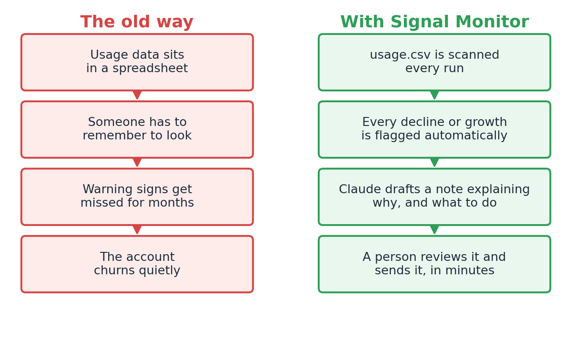
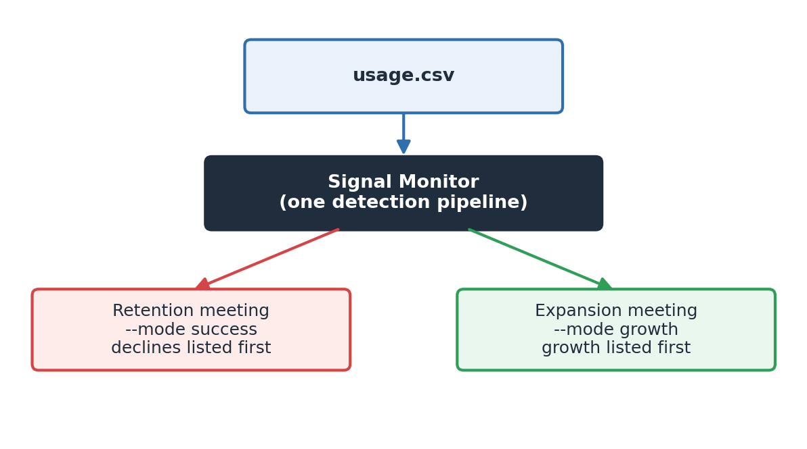

# Signal Monitor

Signal Monitor watches customer usage data and automatically flags accounts that need a customer success or sales conversation, drafting the note for you.

*All company names and numbers in this repository are invented for demonstration.*



## What it does

It reads a spreadsheet of monthly account usage. It flags any account that's declining two months in a row, or growing through a new department, a usage spike, or added seats. For every flag, it asks Claude to name the likely cause and draft a ready-to-send note.



## Example output

Every run produces notes like these — one for a declining account, one for a growing account.

**Decline note — Quantum Flapjack Corp**

> Hi Jordan,
> Over the past few months Support's usage dropped sharply, with tokens falling from 52,000 in February to 28,000 in June while active users fell from 9 to 4 on the same 10 seats.
> I'd like to offer a thirty-minute session with your team to revisit workflows and make sure everyone still has what they need to use the platform effectively.
> Could we grab time this Thursday at 2pm to talk through it?
> Best,
> Priya

**Growth note — Nimbus Noodle Co**

> Nimbus Noodle Co saw total tokens jump 73% month over month in 2026-04 as Sales joined with 15,000 tokens and 4 seats, while Marketing continued steady growth to 23,000 tokens; both departments have since shown consistent month-over-month increases through 2026-06 (Marketing to 25,000 tokens, Sales to 20,000 tokens). The next department to approach at this account is Customer Success, given the natural expansion pattern from Marketing to Sales. The proposed ask is to schedule a discovery call with Customer Success leadership to explore expanding token usage, using the Sales team's rapid ramp-up as proof of adoption to support the conversation.

## What this proves for a sales or customer success leader

This is a small demo, but it's demonstrating a pattern that generalizes to a
real book of business:

- **You don't need a data team to catch account risk and opportunity early.**
  The signal logic here (two-month usage decline, a new department showing
  up, a usage or seat spike) is deliberately simple — the kind of thing
  anyone comfortable with a spreadsheet could define for their own product's
  usage data. The value isn't clever math; it's *acting on the signal
  consistently*, every account, every month, instead of only when someone
  happens to notice.
- **An LLM can turn a raw number into a plausible story and a first draft.**
  Instead of a CSM staring at a chart and guessing why usage dropped, Claude
  reads the account's whole history and proposes a specific, named cause
  (pilot ended, champion left, seasonal, etc.) along with a confidence level
  — and a note that's already 80% of the way to send-ready. That turns a
  vague "something's off with this account" into a concrete next action in
  seconds, for every flagged account, not just the loudest ones.
  **The confidence score matters as a triage tool**: high-confidence signals
  can go straight to a rep as a suggested action, while low-confidence ones
  flag "a human should look at this before we act."
  **All of this still needs human judgment before it reaches a customer** —
  treat the drafted notes as a strong starting point for review and editing,
  not an autosend.
- **The same signal logic works for both defense and offense.** The `success`
  and `growth` modes show that one detection pipeline serves two different
  reviews — a retention/save-desk meeting and an expansion/upsell meeting —
  just by changing which signals get surfaced first. That's one system of
  record for "which accounts need attention," instead of two teams built on
  two different spreadsheets.
- **It scales without scaling headcount.** Whether this covers eight accounts
  or eight thousand, the work per account for a human is the same: read a
  short table, skim a drafted note, decide to send or skip it. The expensive
  part — reading the full usage history and forming a hypothesis — is done
  automatically for every account, every time.

## Run it yourself

Nothing here requires you to know how to code. Follow the steps below in order.

### What you need

- A Mac (any recent one).
- An Anthropic API key. If you don't have one, someone on your team who set
  this project up can give you the `.env` file that holds it — you never need
  to see or type the key itself.

### One-time setup, from a blank Mac

1. **Open the Terminal app.** Press `Cmd + Space`, type `Terminal`, press Return.
   A plain window with a blinking cursor will appear. Every step below is
   something you type into that window followed by Return.

2. **Go to this project's folder.** If the folder is on your Desktop, for
   example, type:

   ```bash
   cd ~/Desktop/01_Signal_Monitor
   ```

   (Adjust the path if the folder lives somewhere else. You can also drag the
   folder into the Terminal window after typing `cd ` with a trailing space,
   and it will fill in the path for you.)

3. **Check that Python is installed.** Type:

   ```bash
   python3 --version
   ```

   If you see something like `Python 3.9.x` or higher, you're set. If you get
   an error, install Python from [python.org/downloads](https://www.python.org/downloads/)
   first, then come back to this step.

4. **Install the two small libraries the program needs.** Type:

   ```bash
   python3 -m pip install anthropic python-dotenv pydantic
   ```

   You'll see some text scroll by — that's normal. It's done when you see the
   cursor blink on a new empty line.

5. **Make sure your API key is in place.** There should already be a file
   called `.env` in this folder with a line like `ANTHROPIC_API_KEY=...` in
   it. You don't need to open it or edit it — the program reads it
   automatically. Never share this file or paste its contents anywhere.

### Running it

From the same Terminal window, type one of these two commands:

```bash
python3 monitor.py --mode success
```

```bash
python3 monitor.py --mode growth
```

- `--mode success` puts accounts that are **losing** usage at the top of the
  results — use this when you're doing a save/retention review.
- `--mode growth` puts accounts that are **expanding** usage at the top —
  use this when you're doing an expansion/upsell review.

Both modes analyze the exact same accounts and produce the exact same notes —
the only difference is which kind of signal you see listed first.

Each run will:

1. Print a table in the Terminal window showing every account with a signal,
   what kind of signal it was, Claude's best guess at the cause, and how
   confident it is.
2. Write a file called `signals.md` in this folder containing the full,
   ready-to-use note for every signal — outreach emails for declines,
   internal notes for growth. Open `signals.md` in any text editor, or
   double-click it — most Macs will open it in TextEdit or Preview.

### Using your own data

The program reads a file called `usage.csv` in this same folder. It's a
simple spreadsheet with six columns: `account`, `department`, `month`,
`tokens`, `seats`, `active_users` — one row per account, per department, per
month. You can open and edit it in Excel, Numbers, or Google Sheets, save it
back out as a `.csv` file with the same name, and re-run the program.

The version included here is sample data for eight made-up companies, so you
can try the tool out before pointing it at anything real.

## About signals.md

The `signals.md` file in this repository is a sample of what the program
produces — output from a real run against the invented data in `usage.csv`,
not something written by hand. Every time you run `monitor.py`, it overwrites
`signals.md` with fresh notes generated by Claude for whatever signals it
finds in your own `usage.csv`.
